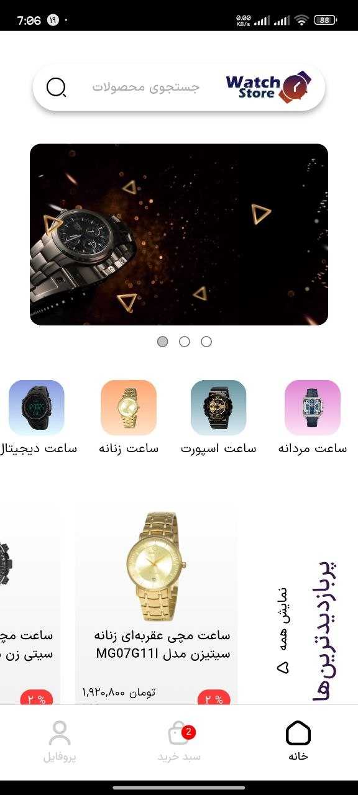
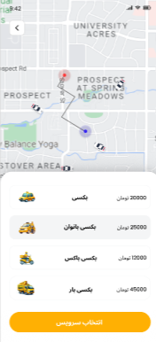
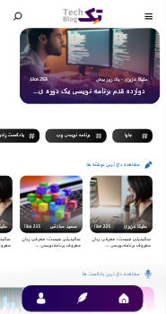

<p align="center">
  
</p>

<p align="center">
  <a href="https://github.com/Muhammad1831"></a>
  <a href="https://www.linkedin.com/in/muhammad-saleh-95a80427b"></a>
  <a href="mailto:muhammad.saleh.dev@gmail.com"></a>
  
</p>

<p align="center">
  <a href="#-featured-showroom"><b>SHOWROOM ↗</b></a> &nbsp;·&nbsp;
  <a href="#-the-person-behind-the-code"><b>ABOUT ↗</b></a> &nbsp;·&nbsp;
  <a href="#-tech-stack"><b>STACK ↗</b></a> &nbsp;·&nbsp;
  <a href="#-lets-build-something"><b>CONTACT ↗</b></a>
</p>

---

### 👋 The person behind the code

I'm **Muhammad Saleh** — a **Mobile Developer (Flutter)** based in Iran, focused on building **Persian-first, RTL-native** mobile apps that feel native, fast, and human.

I turn ideas into shippable Flutter apps: from concept and UI in Figma/XD → clean architecture with **Bloc / GetX** → Firebase / REST integration → polished release on Android, iOS & Web.

> **Ideas are cheap. Shipped apps that people actually use is the craft.**

Currently exploring: advanced state management, offline-first UX, and building a portfolio of production-grade Flutter products.

<p align="center">
  
</p>

*If the image doesn't load yet, upload `assets/how-i-build.png` — a 4-step banner is included in this package for you to generate.*

---

### ✨ Featured Showroom — Real apps. Real code.

> Each preview is an **actual Flutter render** — 4 projects now show **real device captures** (Watch Store • Pitza Mitza • Baxi • TechBlog). Tap the title to open the repository.. Tap the title to open the repository. Screenshots are real app captures (add your own to `docs/showroom/`).

<table>
<tr>
<td width="50%" valign="top">

#### [DariWall — Digital Wallet](https://github.com/Muhammad1831/Dariwall)
<p align="center"></p>

Persian wallet experience: onboarding, balance, transfer/swap, transaction history, missions & invitations. **Product + Flutter RTL**.
<br/>
<sub>Stack: Flutter · Provider · GoRouter · Dio · GetIt</sub> · <a href="https://github.com/Muhammad1831/Dariwall">Source ↗</a> · <a href="https://github.com/Muhammad1831/Dariwall/blob/main/docs/showroom/">Showroom ↗</a>

</td>
<td width="50%" valign="top">

#### [Watch Store — E-Commerce](https://github.com/Muhammad1831/Watch-Store)
<p align="center"></p>

Luxury watch marketplace: catalog, search, cart, authentication with **Bloc** architecture and Persian locale. **3 real captures now live.**
<br/>
<sub>Stack: Flutter · Bloc · Dio · SharedPrefs</sub> · <a href="https://github.com/Muhammad1831/Watch-Store">Source ↗</a>

</td>
</tr>
<tr>
<td width="50%" valign="top">

#### [Pitza Mitza — Food Ordering](https://github.com/Muhammad1831/pitza-mitza)
<p align="center"></p>

Food ordering UX: menu, carousel, categories, cart & checkout flow — optimized for Persian users. **7 real screens now live.**
<br/>
<sub>Stack: Flutter · GetX · GetStorage · Dio</sub> · <a href="https://github.com/Muhammad1831/pitza-mitza">Source ↗</a>

</td>
<td width="50%" valign="top">

#### [Baxi — Ride & Delivery](https://github.com/Muhammad1831/Baxi)
<p align="center"></p>

Ride-hailing & delivery prototype with live maps (`flutter_map`), Firebase, and location services. **6 real screens now live.**
<br/>
<sub>Stack: Flutter · GetX · Firebase · flutter_map</sub> · <a href="https://github.com/Muhammad1831/Baxi">Source ↗</a>

</td>
</tr>
<tr>
<td width="50%" valign="top">

#### [TechBlog — Content Platform](https://github.com/Muhammad1831/TechBlog)
<p align="center"></p>

Persian tech blog: articles, categories, bookmarks, write/publish flow with rich HTML rendering. **6 real screens now live.**
<br/>
<sub>Stack: Flutter · GetX · Dio · cached_network_image</sub> · <a href="https://github.com/Muhammad1831/TechBlog">Source ↗</a>

</td>
<td width="50%" valign="top">

#### [WeatherApp — Minimal Weather](https://github.com/Muhammad1831/WeatherApp)
<p align="center"></p>

Clean weather forecast app — current, hourly & daily views. Lightweight, fast, ready for API integration.
<br/>
<sub>Stack: Flutter · Dart · REST</sub> · <a href="https://github.com/Muhammad1831/WeatherApp">Source ↗</a>

</td>
</tr>
</table>

<p align="center">
  <i>Want the full grid on your personal site like Sajjad's? This README is ready to link to <code>saleh.dev/projects/*</code> when you have it.</i>
</p>

---

### 🛠 Tech Stack

<p align="center">
  
</p>

**Mobile:** Flutter · Dart · Bloc (flutter_bloc) · GetX · Provider · GoRouter  
**Backend & Data:** Dio · REST API · Firebase (Core / Analytics / Messaging / Crashlytics) · GetStorage · SharedPreferences  
**Maps & Media:** flutter_map · flutter_osm_plugin · image_picker / image_cropper · carousel_slider  
**Design:** Figma · Adobe XD · RTL / Persian Typography · Responsive Layouts  
**Foundations:** C · C++ · Git · Clean Architecture

<details>
<summary><b>🧩 Architecture I use</b></summary>
<br>

```
lib/
 ├─ data/        → repositories, data sources, models
 ├─ screens/     → pages + bloc/cubit/controller per feature
 ├─ widgets/     → reusable UI
 ├─ utils/       → helpers, constants, shared prefs
 ├─ gen/         → generated assets
 └─ route/       → GoRouter / GetX routing
```
- Feature-based layers, separation of data / domain / presentation
- State: Bloc for complex flows (Watch Store), GetX for rapid product delivery (Pitza, Baxi, TechBlog)

</details>

---

### 📈 Keep building

<p align="center">
  
  
</p>

<p align="center">
  
</p>

<!-- Snake animation — enable GitHub Actions to generate it daily (see GUIDE.md) -->
<p align="center">
  
</p>
<p align="center"><sub>Real contribution activity. Enable the workflow in <code>.github/workflows/snake.yml</code> to refresh daily.</sub></p>

---

### 🌱 The journey

- **Mobile Developer (Flutter)** — 2022 → Present. Shipping Persian-first apps across e-commerce, food, mobility, and content.
- **C / C++ Foundations** — Games & algorithms (`4-in-row`, `Snake_Game`) → strong DSA grounding before Flutter.
- **Product-minded builder** — I care about RTL UX, empty states, loading & error handling — not just screens.
- **Always learning:** State management deep-dives, offline-first, animations.

---

### 📫 Let's build something

<p align="center">
  <a href="https://www.linkedin.com/in/muhammad-saleh-95a80427b"></a>
  <a href="mailto:muhammad.saleh.dev@gmail.com"></a>
  <a href="https://github.com/Muhammad1831"></a>
</p>

<p align="center">
  <i>Open to Flutter freelance & collaborations — especially Persian-market products.</i><br/>
  <b>Let's make it useful. Good apps start with a conversation.</b>
</p>

---

<p align="center"><sub>Profile inspired by craft-driven builders. Built with Flutter 💙 · Last updated: Oct 2026</sub></p>
